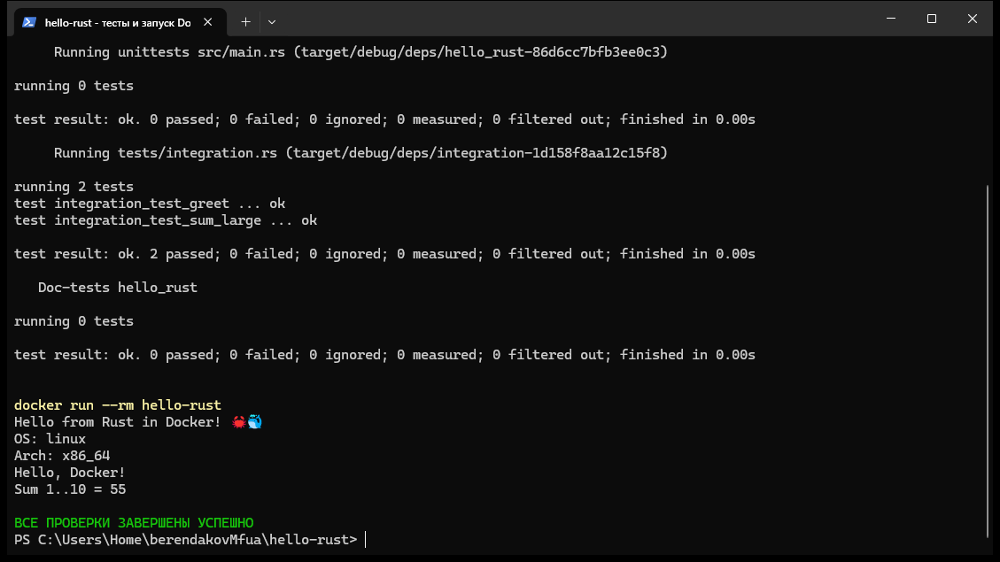
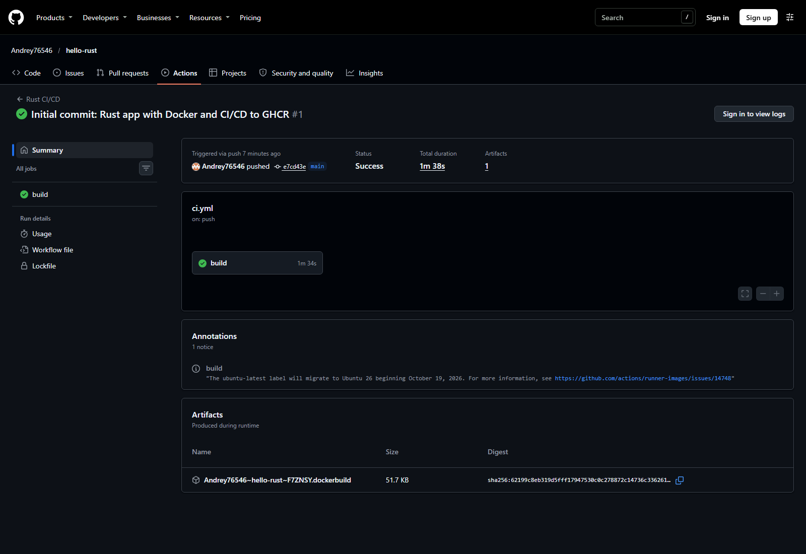
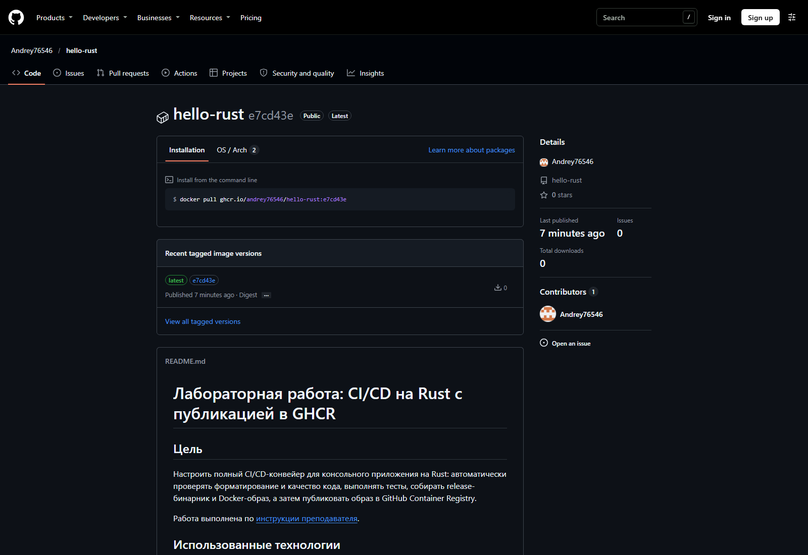

# Лабораторная работа: CI/CD на Rust с публикацией в GHCR

## Цель

Настроить полный CI/CD-конвейер для консольного приложения на Rust: автоматически проверять форматирование и качество кода, выполнять тесты, собирать release-бинарник и Docker-образ, а затем публиковать образ в GitHub Container Registry.

Работа выполнена по [инструкции преподавателя](https://github.com/rurewa/imfua/blob/main/content/DevOps/CI_CD/Pipelines/CI_CD_Rust.md).

## Использованные технологии

- Rust stable, Cargo, rustfmt и Clippy;
- модульные и интеграционные тесты Rust;
- многоэтапная сборка Docker;
- GitHub Actions и Docker Buildx;
- GitHub Container Registry (GHCR);
- встроенный `GITHUB_TOKEN` без пользовательских секретов.

## Что выполнено

1. Реализовано CLI-приложение `hello-rust` с функциями `greet` и `sum_range`.
2. Добавлены два модульных и два интеграционных теста.
3. Настроены обязательные проверки `cargo fmt`, `cargo clippy`, `cargo test` и release-сборка.
4. Создан многоэтапный Dockerfile. Итоговый контейнер запускается от непривилегированного пользователя `appuser`.
5. Настроена автоматическая публикация образа с тегами `latest` и коротким SHA.
6. Для GHCR используются минимальные разрешения `contents: read` и `packages: write`.
7. Опубликованный образ проверен отдельными командами `docker pull` и `docker run`.

## Структура проекта

```text
hello-rust/
├── .github/workflows/ci.yml
├── screenshots/
│   ├── 01-tests-and-docker.png
│   ├── 02-github-actions.png
│   └── 03-ghcr-image.png
├── src/
│   ├── lib.rs
│   └── main.rs
├── tests/integration.rs
├── .dockerignore
├── .gitignore
├── Cargo.lock
├── Cargo.toml
├── Dockerfile
└── README.md
```

## Локальный запуск и тестирование

Rust на хостовой системе не требуется — тесты можно выполнить в официальном контейнере:

```powershell
docker run --rm -e CARGO_HOME=/tmp/.cargo -v "${PWD}:/app" -w /app rust:1-slim cargo test
docker build -t hello-rust .
docker run --rm hello-rust
```

Полный набор проверок CI:

```bash
cargo fmt --check
cargo clippy --all-targets -- -D warnings
cargo test
cargo build --release
```

Ожидаемый вывод контейнера:

```text
Hello from Rust in Docker! 🦀🐳
OS: linux
Arch: x86_64
Hello, Docker!
Sum 1..10 = 55
```

## GitHub Actions и публикация

Workflow [Rust CI/CD](https://github.com/Andrey76546/hello-rust/actions/workflows/ci.yml) запускается при push в `main` и для pull request. Публикация выполняется только при push в `main`, после успешного форматирования, Clippy, тестов и сборки.

- Репозиторий: [Andrey76546/hello-rust](https://github.com/Andrey76546/hello-rust)
- Workflow: [Rust CI/CD](https://github.com/Andrey76546/hello-rust/actions/workflows/ci.yml)
- GHCR-пакет: [hello-rust](https://github.com/users/Andrey76546/packages/container/package/hello-rust)
- Образ: `ghcr.io/andrey76546/hello-rust:latest`

Проверка опубликованного образа:

```bash
docker pull ghcr.io/andrey76546/hello-rust:latest
docker run --rm ghcr.io/andrey76546/hello-rust:latest
```

## Настоящие скриншоты



На снимке показаны реальные локальные тесты, сборка и запуск образа.



На снимке показан завершившийся с зелёным статусом GitHub Actions.



На снимке показаны загрузка и запуск образа из GHCR.

## Вывод

Создан воспроизводимый CI/CD-конвейер: исходный код автоматически проверяется и тестируется, а прошедший проверки Docker-образ публикуется в GHCR и готов к загрузке и запуску на другой системе.
